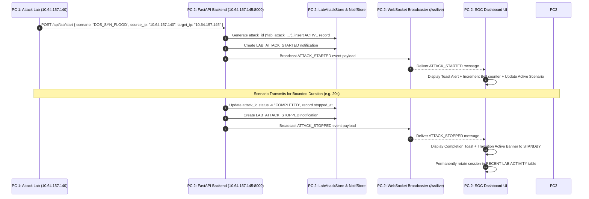

# AI-NIDS: AI-Based Real-Time Network Intrusion Detection System
## Comprehensive System Architecture & Technical Project Manual

---

## 1. Executive Summary & Project Overview

**AI-NIDS** (Artificial Intelligence Network Intrusion Detection System) is a high-performance, real-time cybersecurity platform designed to ingest raw network packet flows, extract statistical and behavioral flow features, classify anomalous traffic using machine learning inference models, and present authoritative telemetry across a centralized Security Operations Center (SOC) dashboard.

The system is built to operate in both **single-machine demonstration modes** and a **physical two-PC laboratory cyber range**, strictly separating the **Remote Attack Generation & Command-and-Control (C2)** plane from the **Sensor Capture, AI Inference, and SOC Detection Authority** plane.

---

## 2. Core Architectural Roles (Two-PC Cyber Range)

```
┌─────────────────────────────────────────────────────────────────────────────┐
│                             PHYSICAL PC 1                                   │
│                     ROLE: ATTACK_LAB / REMOTE CONTROLLER                    │
│                             IPv4: 10.64.157.140                             │
├─────────────────────────────────────────────────────────────────────────────┤
│  ● Vite Frontend Controller (Port 5173)                                     │
│  ● Attack Scenario Dispatch Engine                                          │
│  ● Rate-Bounded Safety Controls (SYN Flood, Port Scan, Brute Force, etc.)   │
│  ● Dispatches REST C2 Commands to PC 2                                      │
└──────────────────────────────────────┬──────────────────────────────────────┘
                                       │
                                       │ Wi-Fi / Ethernet Network Link
                                       │ (REST C2 + WebSocket Live Feed)
                                       ▼
┌─────────────────────────────────────────────────────────────────────────────┐
│                             PHYSICAL PC 2                                   │
│                  ROLE: NIDS_SOC / DETECTION AUTHORITY                       │
│                             IPv4: 10.64.157.145                             │
├─────────────────────────────────────────────────────────────────────────────┤
│  ● FastAPI Authoritative Server (Port 8000)                                 │
│    - Endpoints: /api/lab/start, /api/lab/stop, /api/lab/history, /api/notifs │
│    - Central Event Dispatcher & Deduplication Engine                        │
│    - Authoritative Lab Attack Session Store (LabAttackStore)                │
│    - Authoritative Notification Store (NotificationStore)                   │
│    - Real-Time WebSocket Broadcaster (/ws/live)                             │
│  ● AI Detection & Feature Inspection Pipeline                               │
│  ● Vite SOC Dashboard Frontend (Port 5173)                                  │
│    - Live Traffic Waveform Visualizer & Flow Charts                         │
│    - Lab Activity Feed & Permanent Attack History Table                     │
│    - Notification Bell & Toast Alert Center                                 │
│    - Truthful Threat Metrics & Explainable AI (XAI) Inspection              │
└─────────────────────────────────────────────────────────────────────────────┘
```

---

## 3. High-Level System Workflow & Data Flow



---

## 4. Key Subsystems & Modules

### 4.1. Network Sensor & Telemetry Ingestion
- Ingests packet flows across network interfaces (Wi-Fi / Ethernet / Loopback).
- Computes real-time bandwidth (bytes/sec), packet throughput (packets/sec), active bidirectional flow counts, and protocol distributions (TCP, UDP, ICMP).
- Provides dynamic network interface enumeration and diagnostic health checks.

### 4.2. Feature Extraction Pipeline
Extracts standard statistical flow features compatible with benchmark intrusion datasets (such as CICIDS2017 and UNSW-NB15):
- **Flow Duration & Inter-Arrival Times (IAT)**: Mean, standard deviation, and maximum delta between packets.
- **Flag Distributions**: SYN, ACK, FIN, RST, PSH, and URG packet ratios.
- **Directional Volume Asymmetry**: Forward packets/bytes vs. Backward packets/bytes.
- **Shannon Entropy**: Evaluates source IP entropy and destination port entropy to catch distributed scanning and DDoS activity.

### 4.3. AI Inference & Explainable AI (XAI) Engine
- Evaluates extracted flow features against gradient-boosted decision tree algorithms (XGBoost) and anomaly models (Isolation Forest).
- Produces normalized anomaly scores (0.0 to 1.0), risk scores (0 to 100), and classification probabilities.
- **Explainability Factors (XAI)**: Generates weighted top-contributing factors explaining *why* a particular flow was flagged (e.g., *SYN Packet Ratio: 99.1% [EXCESSIVE]*, *Flow Duration: 12ms [ABNORMAL]*).

### 4.4. Authoritative Event Store & Notification Pipeline
- **Central Event Dispatcher**: All live events (`ATTACK_STARTED`, `ATTACK_STOPPED`, `THREAT_DETECTED`, `THREAT_RESOLVED`) are validated, given unique event IDs (`evt_...`), and recorded in a memory-bounded LIFO ring buffer.
- **LabAttackStore**: Retains completed and active lab simulation sessions indexed by authoritative `attack_id`.
- **NotificationStore**: Maintains notification items (`notif_...`) with read/unread tracking, timestamp, and metadata.
- **REST Endpoints**:
  - `GET /api/lab/history`: Returns full persisted lab attack history.
  - `GET /api/notifications`: Returns full notification history.
  - `POST /api/notifications/read/{id}`: Marks an individual alert as read.
  - `POST /api/notifications/read-all`: Marks all notifications as read.
- **Page Refresh Resilience**: The frontend automatically reconciles state on startup using REST endpoints before listening for live WebSocket messages.

### 4.5. SOC Visual Dashboard & User Interface
- **Truthful Metric Separation**: Clearly isolates real security detections (`Threats Detected: 0`) from controlled lab events (`Lab Attacks: N`, `Active Lab Attacks: 0/1`, `Control Events: N`).
- **Real-Time Traffic Charting**: Interactive area charts displaying live packets/sec and flow metrics with selectable time ranges (1M, 5M, 15M, 1H).
- **Interactive Network Topology**: Visual diagram showing PC 1 Attacker, Communication Link, and PC 2 NIDS/Victim nodes.
- **Top Talkers & Connection Flow Table**: Detailed inspection of active socket pairs with protocol, bandwidth, and anomaly indicators.
- **Notification Bell Dropdown**: Topbar dropdown showing unread badge counts, alert items, and mark-as-read controls.

---

## 5. Supported Attack Simulation Scenarios

| Scenario ID | Name | Category | Protocol | Default Intensity & Window | Description |
| :--- | :--- | :--- | :---: | :---: | :--- |
| `PORT_SCAN` | SYN Stealth Recon Scan | Reconnaissance | TCP | MEDIUM (15s) | Rapid SYN packets across multiple destination ports (1-1024) to identify open listener services. |
| `BRUTE_FORCE` | SSH / HTTP Credential Attack | Credential Attacks | TCP | MEDIUM (18s) | High-frequency connection churn and authentication handshakes against port 22 / 8080. |
| `DOS_SYN_FLOOD` | TCP SYN Flood (Single Source) | Network Availability | TCP | HIGH (20s) | High-rate SYN packet flood with zero ACK completion to saturate listener connection tables. |
| `DDOS_DISTRIBUTED_FLOOD` | Distributed SYN Flood | Network Availability | TCP | HIGH (20s) | Simulated botnet cluster multi-socket availability attack demonstrating source IP entropy surge. |
| `DNS_EXFILTRATION` | DNS Tunneling & Data Exfiltration | Protocol Anomaly | UDP | MEDIUM (15s) | Encoded base64/hex payloads hidden inside anomalous subdomain TXT query requests on port 53. |
| `SUSPICIOUS_FLOW` | Low-and-Slow C2 Beacon | Behavioral Anomaly | TCP | LOW (15s) | Periodic heartbeat beaconing with fixed inter-arrival times and non-standard TLS headers. |

---

## 6. Safety Controls & Cyber Range Governance

1. **Target Lock Restriction**: Simulation dispatch requests are strictly locked to designated laboratory targets (e.g. `10.64.157.145`). Dispatches to unauthorized addresses are rejected with HTTP 403.
2. **Hard Bounded Timers**: Every simulation scenario has an internal timeout (10s to 20s) and automatically triggers an authoritative `ATTACK_STOPPED` signal upon expiration.
3. **Identity Contract Enforcement**: In two-PC mode, the system guarantees that `source_ip` (`10.64.157.140`) is never overwritten by the NIDS server's host (`10.64.157.145`).
